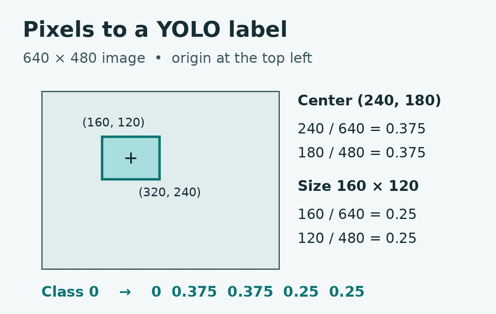
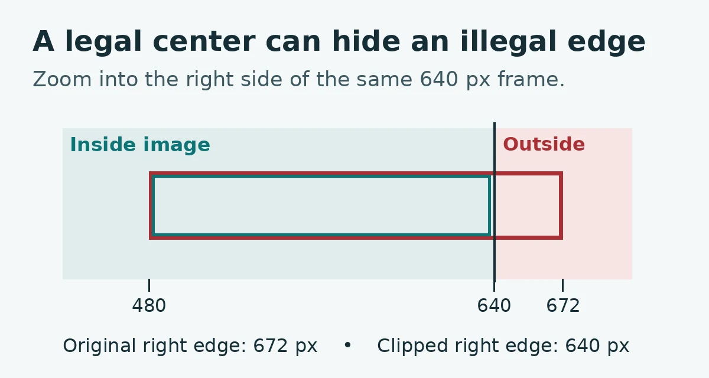

# YOLO Annotation Format: Check Detection Labels Before Training

Use this small Python project to audit bounding box text files without starting a training job. It reports bad geometry, out of range class IDs, duplicate rows and mismatches between image and label names. It never edits a dataset.

**Full lesson:** [YOLO Annotation Format](https://wifarobotics.com/learn/yolo-annotation-format/)

## Start from zero

Install [Python](https://www.python.org/downloads/). Open a terminal and run `python3 --version` on macOS or Linux, or `py -3 --version` on Windows. Use Python 3.10 or newer. No packages, GPU or camera are needed. On GitHub, choose **Code → Download ZIP**, extract it and open a terminal in the directory containing `audit.py`. In the following commands, replace `python3` with `py -3` on Windows.

```sh
python3 examples/make_demo.py demo
python3 audit.py demo/clean --classes 2 --strict-missing
python3 audit.py demo/broken --classes 2
python3 audit.py demo/ambiguous --classes 2
python3 audit.py demo/ambiguous --classes 2 --strict-missing
python3 audit.py demo/clean --split val --classes 2
python3 -m unittest discover -s tests -v
```

| Run | Final line | Exit |
| --- | --- | --- |
| Clean training split | `images=2 valid_boxes=2 errors=0 warnings=0` | 0 |
| Broken training split | `images=1 valid_boxes=0 errors=3 warnings=0` | 1 |
| Missing label, default | `images=1 valid_boxes=0 errors=0 warnings=1` | 0 |
| Missing label, strict | `images=1 valid_boxes=0 errors=1 warnings=0` | 1 |
| Clean validation split | `images=1 valid_boxes=1 errors=0 warnings=0` | 0 |

## Read the format

One row describes one object: `class x_center y_center width height`. Class IDs start at zero. Normalize the two horizontal numbers with the image width and the two vertical numbers with the image height. For a 640 × 480 image with corners (160, 120) and (320, 240), write `0 .375 .375 .25 .25` for class zero. Both reconstructed edges on each axis must fit for this audit to pass.

For your own export, pass the directory that contains `images` and `labels`; for example, pair `images/train/cell1/tray.png` with `labels/train/cell1/tray.txt`. Match the relative path and stem exactly. Read `data.yaml` to check what the IDs mean and pass the number of classes as `--classes`. The tool does not read YAML. It checks PNG and JPEG filenames and five field UTF-8 detection rows with plain decimal coordinates. It does not accept polygons, tracks, pose, scientific notation or prediction rows with confidence.

## Diagnose a finding

- **bounds:** recalculate both corners. Review a visible clipped box in your annotation tool; recompute center and width together.
- **class:** check the class order in the export. Never subtract one from every ID without checking the name map.
- **orphan_label / ambiguous_stem:** compare image and text stems within the same split. Two image extensions sharing a stem compete for the same label.
- **missing_label:** confirm whether the image is background or not yet annotated. A zero byte file can record an intentional negative when the team uses the stricter policy.
- **no_split / no_images:** check the dataset root and supported file extensions. Each call reads one split.
- **Output already exists:** the demo generator preserves old files. Use a fresh name such as `demo2`.

The images are generated rectangles with known coordinates. No training, camera or GPU is involved. This cannot verify image readability, class semantics, missed objects, train and validation leakage, or model accuracy. For real data, open samples in your annotation tool, overlay the decoded boxes, review them and verify the class map before training. Near a boundary this project applies exact arithmetic to the exported decimal strings; its stricter bounds and pairing policies are not a promise that a specific Ultralytics version will give identical errors.

## References and figures

- [Ultralytics detection dataset documentation](https://docs.ultralytics.com/datasets/detect)
- [CVAT Ultralytics YOLO export format](https://docs.cvat.ai/docs/dataset_management/formats/format-yolo-ultralytics/)

The original diagrams in `diagrams/` can be rebuilt with `python3 diagrams/render.py` using Pillow and DejaVu fonts on Linux. Pillow is for figure generation only.




